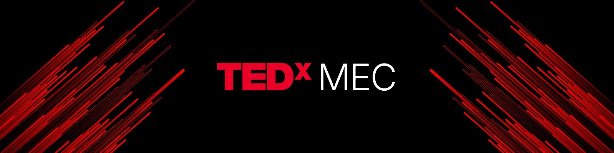

<h1 align="center">TEDxMEC</h1>

  

  <strong>Ideas worth spreading</strong> · <a href="https://tedx.mec.ac.in">TEDxMEC website</a>

---

## About TEDxMEC

**TEDxMEC** is an independently organized TEDx event at
**Government Model Engineering College, Thrikkakara**.

We bring together inspiring speakers, curious minds, and diverse
perspectives to create a platform where ideas can be shared,
challenged, and carried forward.

From technology and science to culture, creativity, society, and
personal experiences, TEDxMEC explores ideas that have the potential
to spark conversations beyond the stage.

## ✦ Our Work

This organization serves as the digital home of **TEDxMEC**.

Here you'll find the websites, platforms, tools, and digital projects
built to support our events and the TEDxMEC community.

## ✦ The TEDx Experience

TEDx events are independently organized events that bring people
together to share ideas and experiences in the spirit of TED's mission
of **Ideas Worth Spreading**.

TEDxMEC carries that spirit forward by creating a space for
thought-provoking talks, meaningful connections, and ideas that
continue beyond the event.

---

  © TEDxMEC · Government Model Engineering College, Thrikkakara

